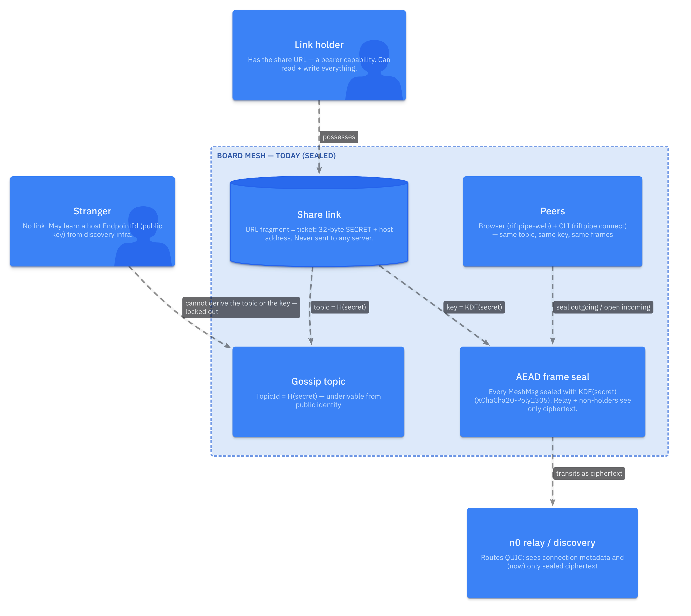
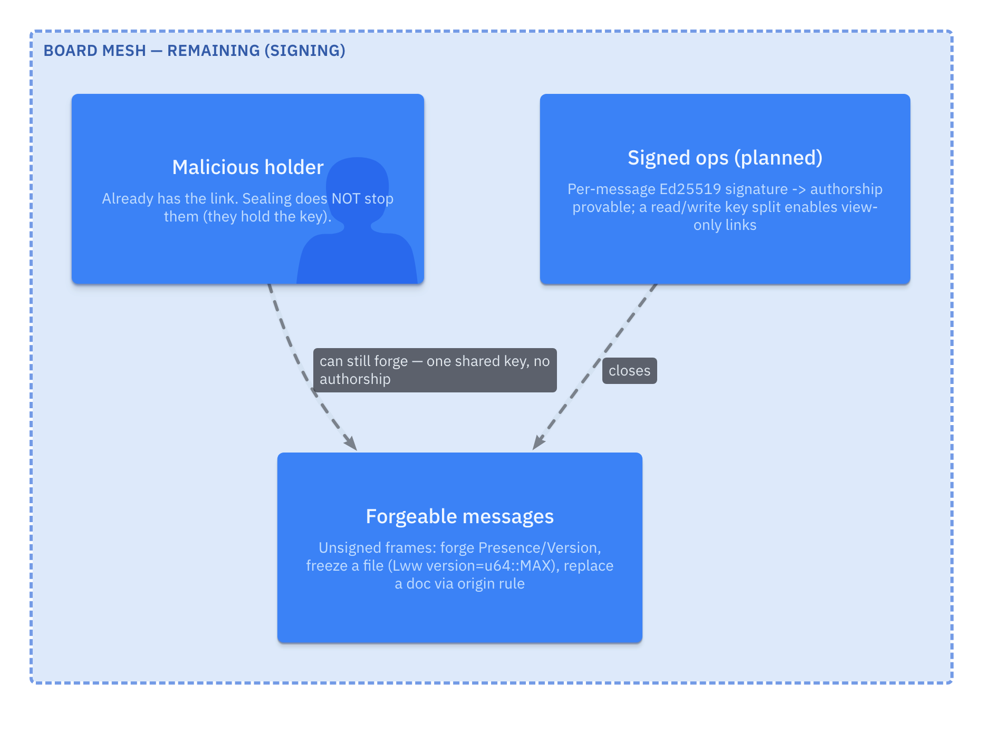

# Security & trust model

This document describes **who can read and write a shared riftpipe board**, what
is enforced cryptographically, and what is not yet. It is deliberately honest
about the boundary: a board is **sealed to link-holders** — outsiders, the relay,
and a DHT are locked out — but among link-holders there is not yet any authorship
or read/write distinction.

Diagrams here are generated from [`likec4/security.likec4`](likec4/security.likec4)
via `npm run diagrams` — edit the model, not the images.

## TL;DR

- **The share link is a bearer capability.** Anyone who has the URL can join a
  board, read everything, and write anything. There are no accounts, roles, or
  per-person access.
- **But only link-holders can find or read a board.** The gossip topic is
  `H(secret)` and every message is AEAD-sealed with a key derived from the same
  secret — so a stranger who only learns the host's public key (or, later, a DHT)
  cannot derive the topic, and the relay carries only ciphertext. (Shipped as
  `PROTOCOL_VERSION` 2; the secret rides the link fragment.)
- **Among holders there is not yet any authenticity.** One shared symmetric key
  means any *holder* can still forge messages attributed to other peers, freeze a
  file, or replace a document — sealing stops outsiders, not insiders. Closing
  that needs **signing** (below), which isn't built yet.
- **There is no per-person revocation.** Removing one person means minting a new
  board (new secret ⇒ new link) and re-sharing with everyone else.

If a board is sensitive, treat the URL like a password: possession is full access,
and anyone you share it with is fully trusted until signing lands.

## Today: sealed to link-holders

### What a share link grants

The share link's URL fragment (`#…`) carries a **ticket**: a 32-byte random
**secret** plus the host's relay/direct address (`hex(postcard((secret, addr)))`,
identical on browser and CLI). The fragment never leaves the browser — it isn't
sent to the Pages server, and doesn't appear in referrers or server logs (the one
property that makes a URL an acceptable place to put a secret at all).

Possession of that link is **full read + write**. There is no invite step, no
approval, no viewer/editor distinction — yet.

### The rendezvous id is derived from the secret

A board is an [iroh-gossip](https://github.com/n0-computer/iroh-gossip) topic, and
the `TopicId` is **`blake3::derive_key("…topic…", secret)`** — a one-way function
of the secret. A stranger who learns the host's public `EndpointId` (which
discovery infrastructure sees, and which a DHT would broadcast) *cannot* derive
the topic, so they can't find the board. This is Hypercore's
`discoveryKey = hash(publicKey)` idea, applied to our gossip topic — and it means
the upcoming DHT/pkarr discovery work no longer widens the attack surface.

### Every frame is sealed

Each gossip frame is AEAD-sealed with **XChaCha20-Poly1305** under a *separate*
key, `blake3::derive_key("…aead…", secret)` (domain-separated from the topic id,
so neither reveals the other). XChaCha's 192-bit nonce lets every peer use a fresh
random nonce with no shared counter — essential in a mesh where everyone encrypts
independently. The relay and any non-holder see only ciphertext and cannot inject
a frame that will decrypt. A peer on the wrong secret lands on a different topic
and never even becomes a neighbor (verified: a one-byte-corrupted ticket never
syncs). Sealing wraps each frame *after* chunking, so it composes with the 4 KiB
chunk framing (a 12 KiB file syncs sealed + chunked, browser↔CLI).

The lot lives in [`core/src/crypto.rs`](core/src/crypto.rs) so native
(`sync::mesh`) and browser (`web::gossip`) derive the identical topic + key and
interoperate.

### What is NOT yet enforced — the insider gap

Sealing stops *outsiders*. It does nothing about a misbehaving *holder*, because
every holder shares the one symmetric key. Gossip's `delivered_from` is the
relaying peer, not the author, and frames are sealed but **not signed**, so any
link-holder can still:

- **Forge `Presence`/`Version`** for other peers (the routing map and the
  version-mismatch banner trust the claimed id).
- **Freeze a structural file** by broadcasting an `Lww` with `version = u64::MAX`
  (LWW versions are unvalidated wall-clock ms — nothing newer ever wins).
- **Replace a whole text document** by crafting one with a higher origin agent id,
  which the origin-conflict adoption rule in `core::sync` accepts.

Closing this is the **signing** follow-on: a per-message Ed25519 signature makes
authorship provable (killing the forgeries), and a read/write key split — a
signing key distinct from the read/seal key — enables genuine **view-only links**.
Both are natural once messages are signed; neither is built yet.

### What the transport already protected

Independently of the above, the iroh/QUIC transport encrypts each hop, so the n0
relay only ever saw ciphertext in transit; the app-layer sealing additionally
blinds the relay to the *topic* and makes the content unreadable even to a peer
that reaches the swarm on a guessed address. The relay still sees **connection
metadata** (which endpoints talk, when).

## Still open

- **Signing (insider authenticity) + read/write split** — described above; the
  next security step.
- **Per-person revocation.** Bearer capabilities can't be revoked individually.
  Rotation *is* the revocation story: mint a new secret ⇒ new topic ⇒ new link
  (the "New board" button already does exactly this), and re-share with the people
  you still trust. Each such rollout that changes the wire is a `PROTOCOL_VERSION`
  bump.

## How other local-first / P2P systems handle this

Researched 2026-07-19 from primary sources. The recurring patterns below are what
the shipped sealing model was built from.

| System | Share capability | Rendezvous vs read key | Read/write split | Revocation | Authenticity |
|---|---|---|---|---|---|
| **riftpipe (today)** | Link = 32-byte secret + host address | **`topic = H(secret)`** — blinded; frames AEAD-sealed with `KDF(secret)` | None yet (link = full access) | None per-person (new secret ⇒ new link) | Sealed but **unsigned** (any holder can forge) |
| **[iroh-docs](https://docs.rs/iroh-docs/latest/iroh_docs/sync/enum.Capability.html)** | `DocTicket` = capability + peer addrs | NamespaceId (public key) is the read cap | **Yes**: `Read(NamespaceId)` vs `Write(NamespaceSecret)` | None documented | Namespace + author signatures |
| **[Hypercore](https://docs.pears.com/building-blocks/hypercore)** | 32-byte public key | **`discoveryKey = hash(publicKey)`** — swarm can't derive read key | Yes (single-writer: secret signs, public reads); Autobase adds `addWriter`/`removeWriter` | Writer removal via Autobase | Per-block signatures |
| **[Earthstar](https://earthstar-project.org/docs/how-it-works)** | Share **address** (read) + **secret** (write) | Address = discovery **and** read | **Yes** (address vs secret; `~@name` path ownership) | None — "make a new share and migrate" | Per-document signatures |
| **[Willow/Meadowcap](https://willowprotocol.org/specs/meadowcap/index.html)** | Unforgeable capability token bound to a pubkey | Peers must *prove* read cap during sync | **Yes** (distinct read/write cap types; delegation chains) | Expiry + owner overwrite | Capability-chain-verified signatures |
| **[Yjs / y-webrtc](https://github.com/yjs/y-webrtc)** | Room name (+ optional password) | Password encrypts signaling traffic — server can't read | None (password gates entry, not role) | New room/password | None (auth is the provider's job) |
| **[@localfirst/auth](https://github.com/local-first-web/auth)** | Seitan-style single-use **invitation** | Transport-agnostic; peers mutually authenticate against a signed team chain | Role-based (lockbox-distributed role keys) | **First-class**: remove member/device + key rotation & re-encryption | Hash-chained signed actions |
| **[Keyhive/Beelay](https://www.inkandswitch.com/keyhive/notebook/)** (Ink & Switch) | Doc = public key delegating to keys/groups | Sync servers get only ciphertext ("pull") | **Yes** (pull < read < write < admin) | **Coordination-free**, via BeeKEM (TreeKEM-style group rekey) | Ed25519-signed ops w/ audience + timestamp binding |
| **[Cabal](https://cabal.chat/)** | Single shared key (`cabal://…`) | Key = discovery + full access (like us) | None | Subjective moderation (per-user, after the fact) | — |
| **[SSB private groups](https://github.com/ssbc/private-group-spec)** | Shared symmetric group key | `group_id` is safe to publish; content is envelope-encrypted | None (one group key) | New **epoch** key on exclusion | — |

### The patterns worth stealing

1. **Blind the rendezvous layer** — derive the discovery/topic id from a one-way
   function of a secret the discovery infrastructure never sees (Hypercore's
   `hash(publicKey)`; y-webrtc's password-encrypted signaling; Keyhive's
   ciphertext-only sync servers). *Shipped* as `topic = H(secret)` + AEAD frames.
2. **Split read from write** — the write key is always a *signing* key, which buys
   authenticity for free. *Not yet:* riftpipe currently has one secret = full
   access, like Cabal and passwordless y-webrtc. This is the signing follow-on.
3. **Sign every operation** — a peer that can *receive* data still can't *inject
   accepted* data without a signing key. *Not yet* — this is what would close the
   forge/freeze/replace insider abuses listed above.
4. **Rotation is the revocation story** — no surveyed system revokes a bearer
   capability per-person; they all rekey an encrypted group and let past-replicated
   data stay readable. Our "new secret ⇒ new link" ("New board") is the same shape.

### The bearer-URL caveat, from the W3C

The [W3C TAG's *Good Practices for Capability URLs*](https://www.w3.org/TR/capability-urls/)
names the two structural limits we inherit by putting a secret in a link: it's
hard to tell a leaked capability from a legitimate one ("there is nothing to
distinguish legitimate access from illegitimate access"), and revocation is
all-or-nothing because the URL "tends to be designed to be the same for everyone."
Their mitigations — HTTPS, `rel="noreferrer"`, keeping secrets in the fragment
(which we do), and issuing *multiple* capability URLs so one can be revoked
without cutting everyone off — are the tools this and the read/write follow-on
lean on.

## Reporting

This is a personal research project, not a production service. If you find a
security issue, open an issue describing it. Nothing here has undergone a formal
security audit; the threat model above is the honest current state, not a
guarantee.
