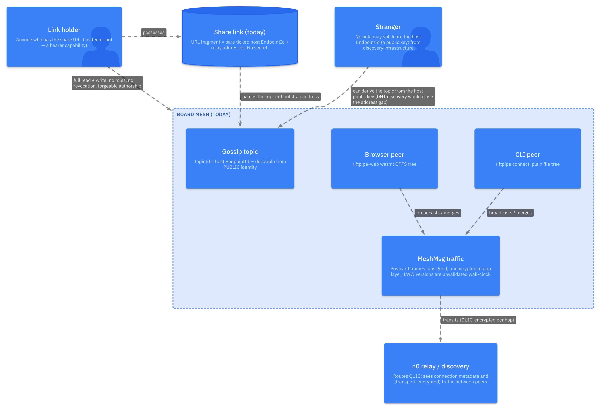
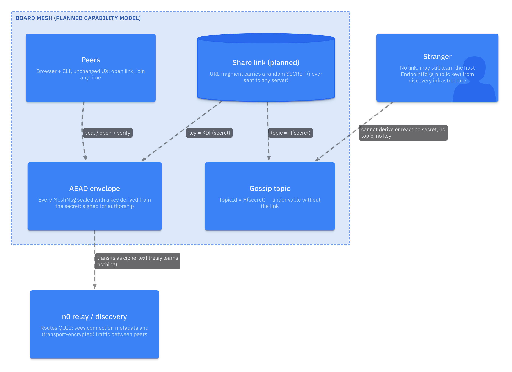

# Security & trust model

This document describes **who can read and write a shared riftpipe board today**,
the specific ways that trust can be abused, and the capability model we intend to
move to. It is deliberately honest about the current state: today the share link
is the only thing standing between a board and the world.

Diagrams here are generated from [`likec4/security.likec4`](likec4/security.likec4)
via `npm run diagrams` — edit the model, not the images.

## TL;DR

- **The share link is a bearer capability.** Anyone who has the URL can join a
  board, read everything, and write anything. There are no accounts, roles, or
  per-person access.
- **The mesh link is weaker than the point-to-point link.** `share`/`join`
  tickets carry a secret and run an authenticated, end-to-end-encrypted
  handshake. The **mesh** ticket (browser share link, `riftpipe connect`) carries
  no secret, and the gossip topic id is just the host's *public* key — derivable
  from public identity.
- **Inside a mesh there is no authenticity.** Any member can forge messages
  attributed to other peers, freeze a file, or replace a document, because
  `MeshMsg`s are neither signed nor app-encrypted.
- **There is no revocation.** Removing one person means minting a new board and
  re-sharing with everyone else.

If a board is sensitive, treat the URL like a password and don't rely on anything
else — because right now, there isn't anything else.

## Today: the URL is the only lock

### What a share link grants

The share link's URL fragment (`#…`) carries a **ticket**: the host's
`EndpointId` plus relay/direct addresses. The fragment never leaves the browser —
it isn't sent to the Pages server, and doesn't appear in referrers or server logs
(the one property that makes a URL an acceptable place to put a capability at all).

Possession of that link is **full read + write**. There is no invite step, no
approval, no distinction between a viewer and an editor.

### The rendezvous id is public identity

A board is an [iroh-gossip](https://github.com/n0-computer/iroh-gossip) topic, and
the `TopicId` is **the host's `EndpointId`** — a public key. Today an attacker also
needs the host's *address* (in the link) to actually connect, but the topic itself
is derivable from public identity. Once DHT/pkarr discovery lands (see the
roadmap), knowing a host's id alone may be enough to find and join a board without
ever seeing the link. That makes the topic-from-public-key choice a latent hole,
not just a theoretical one.

### No authenticity inside the swarm

Gossip's `delivered_from` is the **relaying** peer, not the author, and `MeshMsg`s
are neither signed nor encrypted at the application layer. So any peer already in a
mesh can:

- **Forge `Presence`/`Version`** for other peers (the routing map and the
  version-mismatch banner both trust the claimed id).
- **Freeze a structural file** by broadcasting an `Lww` with `version = u64::MAX`.
  LWW versions are unvalidated wall-clock milliseconds, so nothing newer can ever
  win — a permanent denial of write.
- **Replace a whole text document** by crafting one with a higher origin agent id,
  which the origin-conflict adoption rule in `core::sync` will accept over the
  legitimate history.

None of this requires breaking encryption — it's available to any link-holder.

### What the transport *does* protect

The iroh/QUIC transport encrypts each hop, so the n0 relay routes ciphertext and
cannot read board contents in transit. What the relay *does* see is **connection
metadata** (which endpoints talk, when). The point-to-point `share`/`join` path
additionally runs a secret-based challenge and an end-to-end-encrypted session —
so the file-share flow is meaningfully stronger than the mesh flow. Closing that
gap is what the planned model below is about.

## Planned: a capability link, not just an address

The core idea, drawn from how the local-first ecosystem handles this (see the
comparison below): **put a random secret in the link fragment and derive
everything from it.**

- **Topic = `H(secret)`.** The rendezvous id becomes a one-way function of a
  secret only link-holders have — so a stranger (or a DHT) can't derive the topic.
  This is Hypercore's `discoveryKey = hash(publicKey)` trick, applied to our
  gossip topic.
- **Seal every `MeshMsg` with `KDF(secret)`.** AEAD so the relay and any
  non-holder see only ciphertext, and can't inject accepted messages.
- **Sign for authorship** with the endpoint key, so `delivered_from` can't be
  forged and the origin/LWW abuses above become detectable.

**The join UX does not change.** The secret lives where the ticket already lives —
the URL fragment — so opening the link still means: read the secret, derive the
topic, dial the bootstrap address, decrypt/encrypt with the derived key. No
accounts, no approval, late joiners still catch up via `full_state` on
`NeighborUp`. A nice side effect: because the topic is `H(secret)` rather than the
host's id, the board is no longer tied to one host — any link-holder can be the
first one online, which also helps host-reload and live reconnection.

Two things this still won't do, matching the state of the art:

- **Per-person revocation.** Bearer capabilities can't be revoked individually.
  Rotation *is* the revocation story: mint a new secret ⇒ new topic ⇒ new link,
  and re-share with the people you still trust. (Rolling this out is a
  `PROTOCOL_VERSION` bump, so mixed old/new peers get the version-mismatch banner
  rather than silently failing to find each other.)
- **Read/write split (a later step).** The first cut gives one secret = full
  access, same as today but sealed. Splitting a read key from a write (signing)
  key — so you can hand out view-only links — is a natural follow-on once messages
  are signed.

## How other local-first / P2P systems handle this

Researched 2026-07-19 from primary sources. The recurring patterns below are what
the planned model is built from.

| System | Share capability | Rendezvous vs read key | Read/write split | Revocation | Authenticity |
|---|---|---|---|---|---|
| **riftpipe (today)** | Link = host address; topic = host public key | Topic **is** public identity — no blinding | None (link = full access) | None (new board) | None (unsigned, unencrypted at app layer) |
| **[iroh-docs](https://docs.rs/iroh-docs/latest/iroh_docs/sync/enum.Capability.html)** | `DocTicket` = capability + peer addrs | NamespaceId (public key) is the read cap | **Yes**: `Read(NamespaceId)` vs `Write(NamespaceSecret)` | None documented | Namespace + author signatures |
| **[Hypercore](https://docs.pears.com/building-blocks/hypercore)** | 32-byte public key | **`discoveryKey = hash(publicKey)`** — swarm can't derive read key | Yes (single-writer: secret signs, public reads); Autobase adds `addWriter`/`removeWriter` | Writer removal via Autobase | Per-block signatures |
| **[Earthstar](https://earthstar-project.org/docs/how-it-works)** | Share **address** (read) + **secret** (write) | Address = discovery **and** read | **Yes** (address vs secret; `~@name` path ownership) | None — "make a new share and migrate" | Per-document signatures |
| **[Willow/Meadowcap](https://willowprotocol.org/specs/meadowcap/index.html)** | Unforgeable capability token bound to a pubkey | Peers must *prove* read cap during sync | **Yes** (distinct read/write cap types; delegation chains) | Expiry + owner overwrite | Capability-chain-verified signatures |
| **[Yjs / y-webrtc](https://github.com/yjs/y-webrtc)** | Room name (+ optional password) | Password encrypts signaling traffic — server can't read | None (password gates entry, not role) | New room/password | None (auth is the provider's job) |
| **[@localfirst/auth](https://github.com/local-first-web/auth)** | Seitan-style single-use **invitation** | Transport-agnostic; peers mutually authenticate against a signed team chain | Role-based (lockbox-distributed role keys) | **First-class**: remove member/device + key rotation & re-encryption | Hash-chained signed actions |
| **[Keyhive/Beelay](https://www.inkandswitch.com/keyhive/notebook/)** (Ink & Switch) | Doc = public key delegating to keys/groups | Sync servers get only ciphertext ("pull") | **Yes** (pull < read < write < admin) | **Coordination-free**, via BeeKEM (TreeKEM-style group rekey) | Ed25519-signed ops w/ audience + timestamp binding |
| **[Cabal](https://cabal.chat/)** | Single shared key (`cabal://…`) | Key = discovery + full access (like us) | None | Subjective moderation (per-user, after the fact) | — |
| **[SSB private groups](https://github.com/ssbc/private-group-spec)** | Shared symmetric group key | `group_id` is safe to publish; content is envelope-encrypted | None (one group key) | New **epoch** key on exclusion | — |

### The patterns worth stealing

1. **Blind the rendezvous layer** — derive the discovery/topic id from a one-way
   function of a secret the discovery infrastructure never sees (Hypercore's
   `hash(publicKey)`; y-webrtc's password-encrypted signaling; Keyhive's
   ciphertext-only sync servers). This is our `topic = H(secret)`.
2. **Split read from write** — the write key is always a *signing* key, which buys
   authenticity for free. Systems without the split (Cabal, passwordless y-webrtc,
   riftpipe today) are the outliers.
3. **Sign every operation** — a peer that can *receive* data still can't *inject
   accepted* data without a signing key. This is what closes the forge/freeze/
   replace abuses listed above.
4. **Rotation is the revocation story** — no surveyed system revokes a bearer
   capability per-person; they all rekey an encrypted group and let past-replicated
   data stay readable. Our "new secret ⇒ new link" is the same shape.

### The bearer-URL caveat, from the W3C

The [W3C TAG's *Good Practices for Capability URLs*](https://www.w3.org/TR/capability-urls/)
names the two structural limits we inherit by putting a secret in a link: it's
hard to tell a leaked capability from a legitimate one ("there is nothing to
distinguish legitimate access from illegitimate access"), and revocation is
all-or-nothing because the URL "tends to be designed to be the same for everyone."
Their mitigations — HTTPS, `rel="noreferrer"`, keeping secrets in the fragment,
and issuing *multiple* capability URLs so one can be revoked without cutting
everyone off — are the same tools the planned model would reach for.

## Reporting

This is a personal research project, not a production service. If you find a
security issue, open an issue describing it. Nothing here has undergone a formal
security audit; the threat model above is the honest current state, not a
guarantee.
