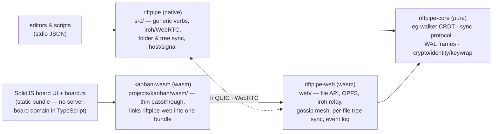
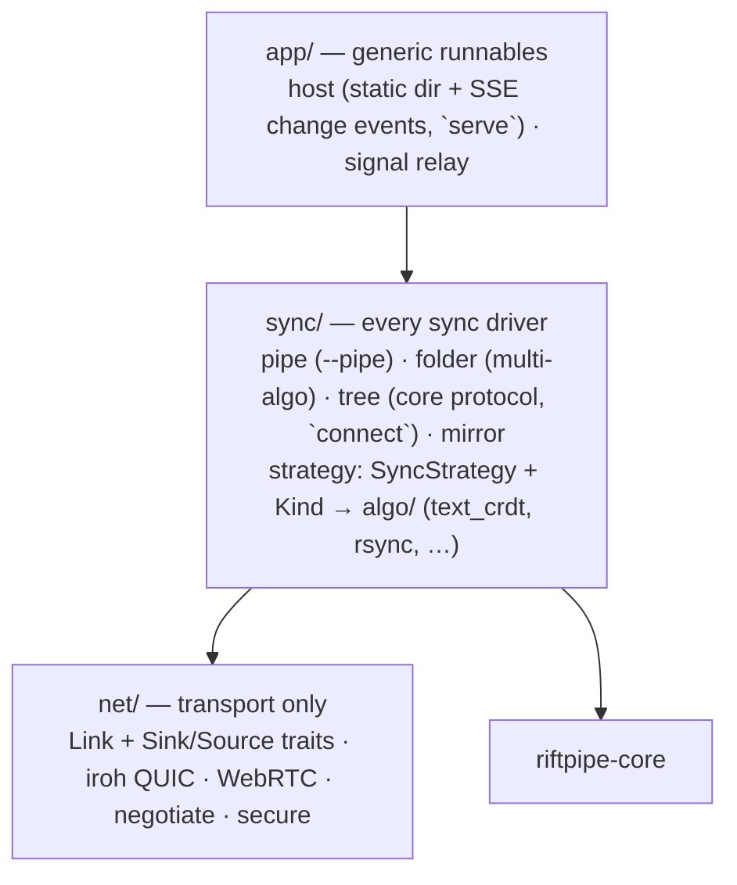
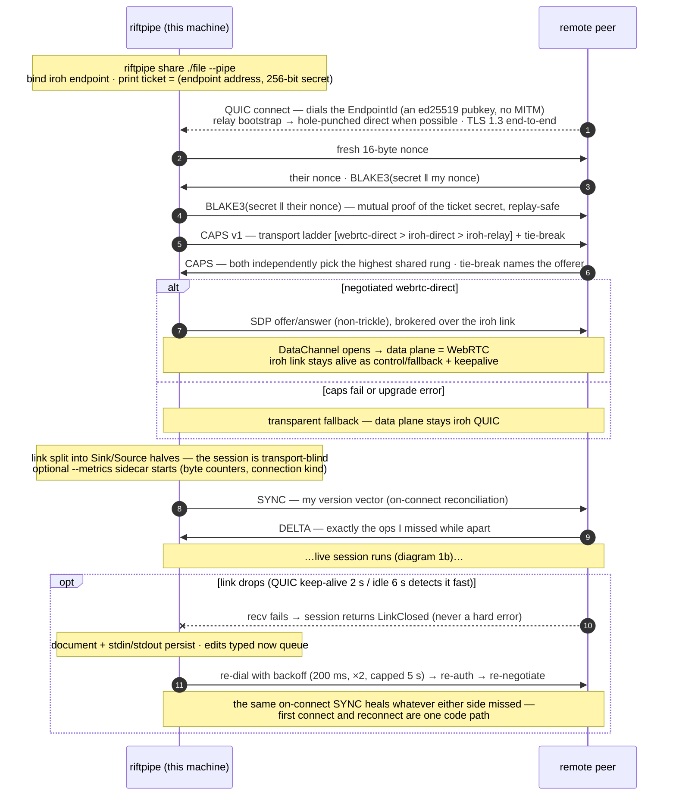
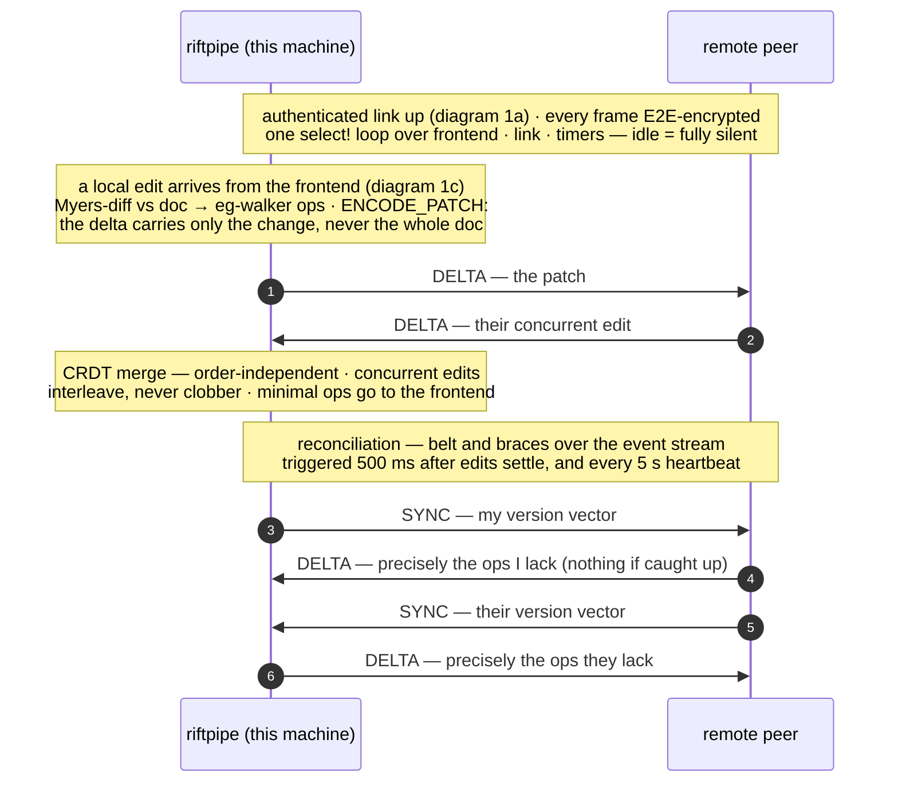
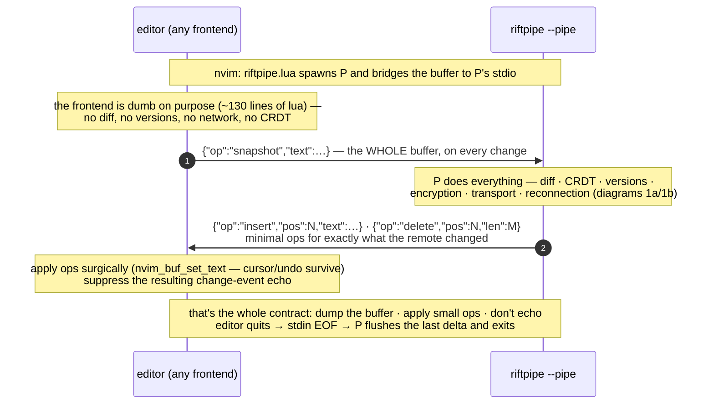
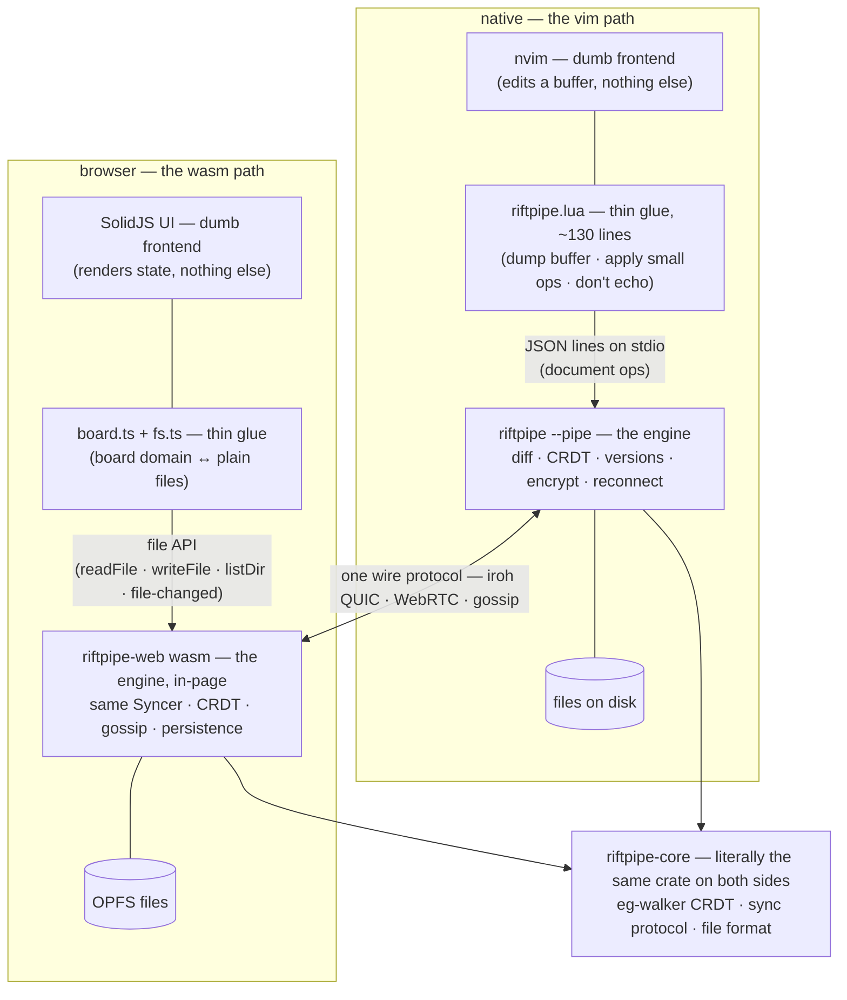
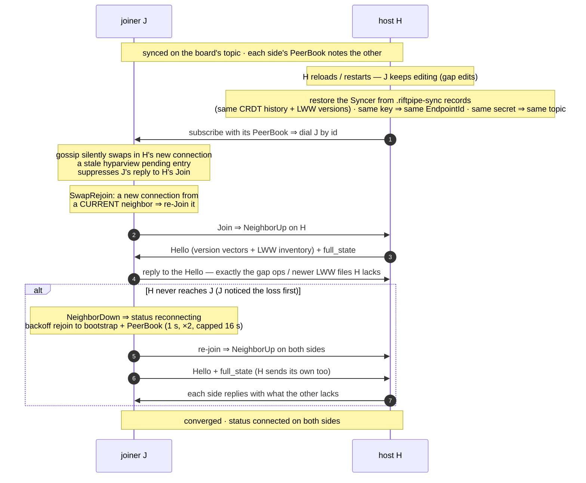

# riftpipe — architecture map

> What actually exists and how it fits together, at the crate/module level.
> The deep design rationale lives in `DESIGN.md`; status in `PROJECT.md`.
> (From the July 2026 code review; update when the layout shifts.)

## Repo layout

```
riftpipe/
  Cargo.toml            root package (native binary) + workspace [core], exclude [web]
  core/                 riftpipe-core — pure, wasm-safe, the single source of truth
  src/                  the native `riftpipe` binary (lib + main) — generic verbs only:
                        share · join · connect · serve · signal
    net/                transport: Link + Sink/Source seams, iroh QUIC, WebRTC,
                        negotiate (caps ladder + NegotiatedSession/Link), secure
    crdt/               re-export shim over riftpipe_core::text
    sync/               every sync driver: --pipe, mirror, folder, tree
      strategy.rs       the SyncStrategy trait + Kind (folder mode's Strategy seam)
      algo/             text_crdt, rsync, wal, lww_record (real); image (stub)
    monitor/            metrics + in-memory `process` sidecar
    app/                generic runnables: host (static + SSE), signal relay
  web/                  riftpipe-web — app-generic wasm crate (workspace-excluded,
                        own lockfile): links, gossip mesh, OPFS, tree sync,
                        auth, the file API (file.rs) + synced event log (events.rs)
  projects/kanban/      the showcase app: SolidJS UI + board domain in TypeScript
                        (src/board.ts over the src/fs.ts file wrapper) + kanban-wasm
                        (wasm/ — a thin passthrough linking riftpipe-web into the
                        one in-page bundle; no kanban Rust, no server) + e2e + seed board
  nvim/                 Neovim bridge (session-local lua)
  tests/                native integration tests (mock, real iroh, full stack)
  deploy/               fly.io signaling server (legacy/fallback transport)
  docs/                 this file, deploy guide, planned/ (proposals & decisions)
```

## Crate view

Everything that merges, resolves conflicts, or defines a wire format lives once,
in `riftpipe-core` (no I/O, no clock, no transport — compiles native and wasm).
The two platform crates only add transport + storage; the UIs only render.



## Native layers (src/)

Strictly one-directional; each layer only sees the seam below it. The `monitor/`
sidecars (byte counters, in-memory resource report) and the `crdt/` shim are
omitted — they hang off these layers without affecting the shape.



Why the seams hold:

- **`net` exposes two traits and nothing leaks up.** `Link` (whole channel) and
  `Sink`/`Source` (split halves) are the only things the layers above name;
  `net::negotiate::negotiate_session_halves` performs the caps exchange +
  optional WebRTC upgrade and hands back boxed halves, so `sync` never sees a
  concrete transport type.
- **`sync` is the single home for drivers.** `pipe`/`folder` speak the native
  wire formats; `tree` speaks `riftpipe_core::sync` (the browser protocol) so
  native and browser peers interoperate on any file tree. Folder mode now
  rides the same `SyncMsg` envelope too (strategy-channel variants), so there
  is one wire protocol with two dialects.
- **`app` is generic.** `host` serves a static dir + SSE change events (the
  `serve` verb, also consumable as a library); `signal` relays SDP blobs.
  `connect` dials a link and hands the halves to `sync::tree::run`. No app
  nouns anywhere in the binary.

## The two flagship data paths

**1. Editor collaboration (`--pipe`)** — one peer's view, in three focused
diagrams: how a link comes up (and comes back), what flows over it, and the
tiny contract an editor signs. Drawn from the `share` side; `join` is the
mirror image (decodes the ticket and dials instead of accepting).

### 1a. Connection & reconnection (riftpipe ↔ riftpipe)



### 1b. Sending data (riftpipe ↔ riftpipe)



### 1c. The pipe protocol (editor → riftpipe)

The editor side is deliberately trivial — riftpipe does all the thinking. Any
program that can print JSON lines is a peer: the nvim bridge, a script, a bot.



**2. Browser kanban (serverless)** — browser ↔ browser over the gossip mesh:
the UI calls the board domain in `projects/kanban/src/board.ts` (TypeScript),
which reads/writes plain files through `fs.ts` — a thin wrapper over
riftpipe-web's generic file API (`readFile`/`writeFile`/`listDir`, over OPFS).
Every `writeFile` is pushed through `core::sync::Syncer`
(`card.md` → text-CRDT event, `meta.toml` → LWW) and broadcast on the
iroh-gossip topic; receiving peers merge, land files back into OPFS, and fire a
per-path `riftpipe:file-changed` event that `fs.ts`'s `watch` turns into a
re-read. New neighbors are caught up with `full_state()` on `NeighborUp`. A
native peer joins the same board with the generic `riftpipe connect`, whose
`sync::tree`/`sync::mesh` drivers speak the identical protocol against a real
directory — neither the binary nor the wasm library knows it's a kanban board.

## One bridge pattern, two dialects (vim vs wasm)

The native editor path and the browser path are the **same four layers**: a
dumb frontend, a thin glue file, the riftpipe engine owning everything hard,
and files as truth. The only real difference is the wire dialect the glue
speaks — JSON lines on stdio for the terminal world, a small file API
(read/write/list a path, watch for changes) for the web — because each is what
that world's developers already know. The frontend never sees a CRDT, a
version vector, or a socket in either column.



Layer-by-layer, the correspondence is exact:

| concept              | vim path                          | wasm path                          |
|----------------------|-----------------------------------|------------------------------------|
| dumb frontend        | nvim buffer                       | SolidJS store/UI                   |
| thin glue            | `nvim/riftpipe.lua`               | `projects/kanban/src/{board,fs}.ts`|
| glue's dialect       | JSON lines on stdio (document ops)| file API (read/write/list + watch) |
| the engine           | `riftpipe --pipe` process         | `riftpipe-web` wasm in the page    |
| where files live     | the real filesystem               | OPFS (the browser's private fs)    |
| merge/versions/wire  | `riftpipe-core`                   | `riftpipe-core` (same crate)       |

The dialects sit at slightly different altitudes: an editor's natural unit is
*document edits*, so the pipe carries ops against one text; the web glue works
in *whole files*, so the app's TypeScript maps cards and comments onto paths
(`board.md`, `tickets/<id>/{card.md,meta.toml}`, `comments/*.md`) and the
engine decomposes each write into per-file CRDT/LWW sync underneath — the same
layout a native `riftpipe connect` working copy shows as real files.

## Mesh reconnection

A board's peers (browser tabs and `riftpipe connect` CLIs) share one
iroh-gossip topic. When one of them reloads or restarts, it comes back as the
*same* peer on the *same* board: its key and board secret persist (localStorage,
or `<dir>/.riftpipe-host`), and its per-path sync history persists in the
never-synced `.riftpipe-sync/` dir and is restored before the mesh starts. A
`Hello` on every `NeighborUp` makes a one-sided reconnect pull what the other
side has and we lack; a neighbor that re-dials us after a same-key restart is
re-Joined, because iroh-gossip would otherwise leave the restarted side without
a NeighborUp (`core::reconnect::SwapRejoin` documents the hyparview cause).
Policy (backoff, peer book, swap re-Join, link state) lives in
`core::reconnect`; both drivers (`src/sync/mesh.rs`, `web/src/gossip.rs`) apply it.



## Known seams & wrinkles

Fixed in the July 2026 restructure + review series:

- ~~Two unrelated types named `Syncer`~~ — folder mode's trait is now
  `SyncStrategy` (`sync/strategy.rs`); `Syncer` unambiguously means the
  `riftpipe_core::sync` protocol.
- ~~`sync` knew concrete transports~~ — the `Sink`/`Source` halves traits and
  `negotiate_session_halves` moved into `net`; drivers are transport-blind. The
  binary's duplicate negotiation orchestration is gone (`NegotiatedSession` /
  `negotiate_link`, one policy).
- ~~`net` depended on the CRDT~~ — `sync_full` moved from `net/link.rs` to `sync/`.
- ~~Kanban code in the binary~~ — the sync driver is the app-neutral
  `sync::tree` behind `riftpipe connect`; static hosting is generic
  `app::host`; verbs are all generic. The kanban servers themselves (Deno
  reference, then a brief `kanban-server` crate) were subsequently **removed
  entirely** — the app's backend runs in the page (TypeScript over the wasm
  file API, since the "filify" change deleted `kanban-wasm`'s Rust handler).
- ~~Board-sync correctness debt~~ — dotfile leak (`.site`) fixed both
  directions; guard-across-await + triple Arc/Mutex replaced by one select!
  loop with caller-owned `TreePeer`; unbounded echo map → blake3 `seen`;
  watcher failure degrades to poll; first mock-halves tests.

Since fixed in later passes: `connect` speaks all three transports (native
iroh ticket + `--accept`, a **browser share link** via the iroh-gossip mesh —
`core::sync::MeshMsg`, one wire type for `sync::mesh` and `web`'s
`GossipTreeSync`, proven by the `board-cli-mesh` e2e — and the signaling
room fallback); the sqlite orphan became `Kind::LwwRecord` (sqlite.rs
deleted); `web/Cargo.lock` is tracked.

Since then: the wire protocols were unified — folder mode's bespoke framing is
gone; it speaks postcard-encoded `core::sync::SyncMsg` via the appended
strategy-channel variants (`StratAdvert`/`StratDelta`), wire-compatible with
deployed peers (old peers skip unknown variants; guarded by `wire_compat`
tests in `core::sync`).

Since the protocol + security series (`docs/planned/roadmap.md` §Security):
the browser bundle is a generic **file library** (`web/src/file.rs`:
`readFile`/`writeFile`/`listDir`, per-path `riftpipe:file-changed` events)
plus a synced per-device **event log** (`web/src/events.rs`: `logEvent`/
`readEvents`, `events/<device-id>.jsonl`, `riftpipe:event`); `kanban-wasm`
carries no Rust of its own. Mesh frames are AEAD-sealed under the ticket
secret, and writes on a claimed board are signed and checked against the
replicated trust log (claim / request-to-join / approve via `MeshMsg::Trust`
and `MeshMsg::Request`) — see `docs/security/`.

Still open (tracked in `docs/planned/roadmap.md` §Architecture / hygiene):

- **Two deploy stories** — Pages ships the iroh app; `deploy/` + workflow vars
  still treat the signaling server as first-class. (The kanban servers
  themselves are gone — the app's backend runs in the page.)
