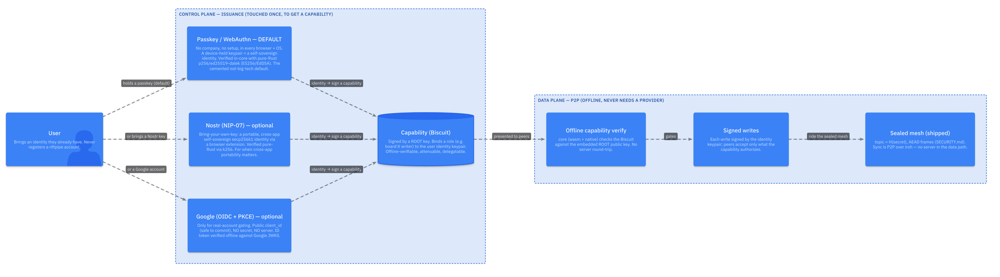

# Auth & identity (planned)

**Status: design, not built.** The sealing layer that closes the *outsider*
threats (secret-derived topic + AEAD frames) is shipped — see
[`SECURITY.md`](../../SECURITY.md). This document is the plan for the *next*
layer: **who** a peer is, and **what** they're allowed to do — without hosting a
server or committing a secret.

Diagram generated from [`likec4/auth.likec4`](../../likec4/auth.likec4) via
`npm run diagrams`.

## Goals & constraints

- **Host nothing.** No auth server in the data path. A board must keep syncing
  peer-to-peer with any identity provider offline.
- **Commit no secret.** Nothing in the repo should be sensitive. (Public
  identifiers are fine — see the PKCE note below.)
- **Use identities people already have.** Don't make users register a riftpipe
  account. Google for reach ("everyone has one"); a not-big-tech companion for
  people who'd rather not use Google.
- **Verify offline, in wasm + native.** The check runs in `core` on both the CLI
  and the browser, against pure-Rust crypto only (no `ring`, no `openssl`).
- **The data plane never changes.** Identity is just "which keypair signs
  writes"; the sealed mesh and CRDT sync are untouched.

## The shape: two planes

Split the system into a **control plane** (proving who you are and getting a
capability — this may touch a provider, and is touched *once*) and a **data
plane** (using the capability — pure P2P, offline, provider never involved).

- **Control plane / issuance.** A provider vouches for your identity, and that
  yields a **capability**: a signed token binding a role to your identity
  keypair. This is the only step that might contact an external service.
- **Data plane / verification.** Peers verify the capability **offline** against
  an embedded **root public key** — no server round-trip — and accept a write
  only if the capability authorizes it. Sync stays P2P over iroh, sealed as
  today.

The load-bearing idea: **the verifier only ever checks a signature against a
public key.** It does not care whether the root of trust is a person's
self-signed board genesis or a hosted, Google-backed issuer. So "which provider"
is a *deployment choice plugged in at the root*, not a fork in the code.

## Clearing up the "secret in the repo" fear

OAuth conflates two things:

- **`client_secret`** — genuinely sensitive, never commit. Only needed for
  *confidential* (server-side) clients. A browser or native app is a **public
  client** and uses **PKCE**, which has **no secret at all**.
- **`client_id`** — a *public identifier*, safe to commit (it's in every login
  URL by design). With PKCE, plus the redirect-URI allowlist you control at the
  provider, a committed `client_id` grants nothing an attacker can abuse.

And crucially: **verifying** a provider-signed token needs **no registration at
all** — a peer just checks it against the provider's public JWKS keys. The
one-time registration exists only to *start* a login and stamp the token's
audience. So: no secret committed, nothing hosted, and the login flow runs
entirely in the browser.

## Decision: passkeys (non-big-tech default) + Google (optional reach)

**The cemented non-big-tech identity is passkeys / WebAuthn.** It is the only
option that satisfies *every* constraint at once: owned by **no company** (a
FIDO Alliance / W3C open standard), already built into **every current browser
and OS** ("built for anyone to use already"), **nothing to host**, **nothing to
register**, **no secret to commit**, and it yields exactly the **self-sovereign
keypair** the capability model wants. **Google (OIDC + PKCE)** is an *optional*
add-on for boards that specifically need real-world accounts — not the default,
and never required.

### Passkeys / WebAuthn — the identity

The user authenticates with Face ID / Touch ID / a device key. The credential is
a keypair; peers verify its signatures. You are your own **relying party** (your
own app origin — e.g. the GitHub Pages domain), so there is **no third party and
no auth server**: the create/get ceremony runs entirely in the browser via
`navigator.credentials` (`web-sys` bindings), and verifying an assertion is a
local signature check any peer can do.

- **Pro:** zero setup, zero provider, best-in-class UX, self-sovereign — doubles
  as the anonymous-identity primitive (a fresh keypair, no real-world name), and
  syncs across a user's devices via their platform/password-manager passkey
  store (iCloud Keychain, Google Password Manager, 1Password, Bitwarden).
- **Con:** proves "same credential as before," not "this is alice@gmail.com,"
  and a credential is scoped to one origin (not a portable cross-app identity).
  For a personal board that's exactly what you want.
- **Crypto fit (the load-bearing bit — verified 2026-07-19):** a WebAuthn
  assertion signature is computed over exactly
  `authenticatorData ‖ SHA-256(clientDataJSON)` (W3C WebAuthn §6.3.3). We
  **require ES256 (COSE −7, P-256/ECDSA) or EdDSA (−8, Ed25519) credentials** and
  verify the assertion **in-core with the pure-Rust `p256` / `ed25519-dalek`
  crates we already pull in** — **no `openssl`, no `ring`**, so it compiles to
  `wasm32-unknown-unknown`. Two things the verifier must get right:
  1. **ES256 signatures are ASN.1 DER**, not raw `r‖s` — parse with
     `p256`'s `Signature::from_der` (don't assume a fixed 64-byte layout).
  2. Advertise `pubKeyCredParams: [-7, -8]` at credential creation so
     compliant authenticators mint ES256/EdDSA. Native **Windows Hello has
     historically preferred RS256 (−257)**, which `p256`/`ed25519-dalek` don't
     cover — accepting only −7/−8 excludes some *native* Windows Hello
     credentials (a shrinking edge: Win11's third-party passkey providers —
     1Password, Bitwarden, Google — mint ES256). A deliberate, acceptable
     exclusion; not a spec guarantee.
- **`webauthn-rs` is native-only.** It's a solid server-side RP library but its
  verification path is still **OpenSSL-bound** (issue #423 for a pure-Rust
  backend was closed unmerged), so it is **disqualifying for wasm** and must not
  go in `core`. Use it, if at all, only on the native side; the core verifier is
  our own ~small `p256`/`ed25519-dalek` check.
- **The browser ceremony** runs entirely client-side via `navigator.credentials`
  (`web-sys` has the bindings, behind `--cfg=web_sys_unstable_apis`). The
  relying party is just the page origin — a static host (GitHub Pages) needs no
  auth server. A credential is bound to that origin (`rpIdHash`), so it can't be
  asserted from a different domain.

### Google (OIDC + PKCE) — optional, for real accounts only

Only when a board must be gated to real accounts (e.g. only `@company.com`).
Public `client_id` (committed, no secret), login runs in the browser, and peers
verify the ID token **offline against Google's JWKS**.

- **Cost:** one ~5-minute, one-time OAuth-app registration for the committable
  `client_id` + redirect allowlist. Not hosting, not a secret, not per-user.
- **Caveat:** Google signs **RS256** (pure-Rust `rsa` crate — heavier than
  Ed25519 but wasm-fine).

### Nostr — the optional portable, cross-app identity

The one place passkeys are structurally weak is **portability**: a passkey is
bound to one origin, so it's an authenticator *for this app*, not an identity a
user carries across apps. If that matters to the P2P vision, **Nostr** is the
best complement and the only reviewed option that beats passkeys on that axis:

- The identity is a raw self-sovereign **secp256k1 keypair**; a NIP-07 browser
  extension (Alby, nos2x) exposes `window.nostr.getPublicKey` / `signEvent`, so
  integration is trivial and there's **no hosting and no company**.
- Verification is **pure-Rust wasm-clean via `k256`** (RustCrypto, BIP-340
  Schnorr) — no `ring`/`openssl`.
- Trade-off: assumes the user has a Nostr extension (no native OS UX), and key
  backup is the user's problem (no Secure Enclave / iCloud escrow). Adoption is
  niche today.

Offer it as an *optional* "bring-your-own-key" identity alongside passkeys, not
the default.

### Other non-big-tech options (later, if wanted)

Additional roots plugged into the same verifier — no new machinery:

- **IndieAuth** — your-own-domain identity, decentralized in spirit, but the user
  must own/host a domain and it's an OAuth redirect (not a local signature
  check), so it's a poorer fit for a zero-server static app.
- **GitLab OIDC** — a real-account provider that isn't Google/Microsoft; same
  committable-`client_id` shape as Google.
- **did:key / SIWE** — maximally decentralized keypair identities, but did:key
  has no browser signing UX (you'd rebuild key management → effectively Nostr
  without the ecosystem) and SIWE drags in wallet/crypto-culture baggage.

## The capability token: Biscuit

For the signed, offline-verifiable capability, use **Biscuit**
([`biscuit-auth`](https://crates.io/crates/biscuit-auth)):

- Pure-Rust crypto (`ed25519-dalek` + `p256`), **no `ring`** — compiles to
  `wasm32-unknown-unknown`; there's an official `biscuit-wasm` too.
- A central **root keypair** signs tokens; **any peer verifies offline** against
  the root public key.
- Roles ride as **Datalog** facts/checks (e.g. a check that the token grants
  `write` on `board:X`).
- **Offline attenuation** — a holder can *narrow* their own token (add an
  expiry, scope it to one board, sub-delegate) without contacting the issuer.
  This is what makes "admin delegates, holder restricts" work in a leaderless
  mesh, and is why Biscuit beats a plain signed JWT here.

A plain **EdDSA-signed token** (`ed25519-dalek`, or `jsonwebtoken` v11's
ring-free `rust_crypto` backend, or PASETO) is a fine *v1* if attenuation isn't
needed yet — but adopting Biscuit's format up front avoids a migration.

## How it plugs into riftpipe

- **Identity keypair.** Each peer already persists one (the iroh key,
  `riftpipe:iroh_sk`). Prefer a *separate* app-level signing key so the
  board-author identity isn't linkable to the relay-visible EndpointId (better
  anonymity). The passkey/Google flow vouches for *this* key.
- **Capability lives in the tree.** The Biscuit is just a signed file that syncs
  like any other (dot-pathed if it should stay local, or shared if peers need to
  see each other's caps).
- **Verification hook.** `core::sync::Syncer::apply` gains a check: a write is
  accepted only if it's signed by a key whose capability (verified against the
  root) authorizes that path/role. This is the same seam the LWW-freeze and
  origin-replace abuses in `SECURITY.md` are exploited through, so it's exactly
  where the fix belongs.
- **Membership / roles.** A signed, append-only membership log (genesis =
  self-signed board creator, or the hosted root) records add/remove/delegate.
  It's replicated like any file; peers verify signatures on apply.
- **Revocation.** Short capability TTLs plus an optional signed revocation list
  (gossiped like any file). Per-person *read* revocation still needs seal-key
  rotation (the group-key-rotation frontier) — deferred until actually needed;
  "New board" (new secret ⇒ new link) is the blunt version we already have.

## Build order

1. **Signing** — peers sign writes with an app-level keypair; receivers verify.
   Kills the forge/freeze/replace insider abuses on a flat membership. No
   provider, no roles yet. *This rung is independent of every provider choice —
   build it first.*
2. **Capabilities** — introduce Biscuit; verify offline against a root key;
   root = self-signed genesis to start (pure P2P, zero infra).
3. **Identity front door** — wire passkeys (then Google/PKCE) so a real or
   self-sovereign identity vouches for the signing key.
4. **Membership + roles** — the signed log; role-gated writes; invite-based
   onboarding (single-use tokens, à la `@localfirst/auth`'s Seitan pattern).
5. **Read revocation** — seal-key rotation on removal. The hard, frontier rung;
   defer.

## Alternatives considered (and why not)

- **Self-hosted IdP (Keycloak/Ory/Zitadel) or a custom `openidconnect` issuer** —
  rejected: violates "host nothing." (A custom issuer minting Biscuits is viable
  *if* we ever accept running one service, but it's not the default.)
- **Macaroons** — rejected: chain HMAC caveats, so every verifier needs the
  shared signing secret — any peer could mint tokens. Biscuit's public-key model
  is the correct P2P shape. (The Rust `macaroon` crate is also unaudited.)
- **UCAN (Rust `rs-ucan`)** — conceptually ideal (DID delegation, offline
  verify) but the Rust implementation is WIP/unaudited and the spec is still
  stabilizing; too much integration risk today. Revisit as it matures.
- **`@localfirst/auth`** — JS-only, not usable from the Rust core; kept as a
  *design reference* for the invite→verify membership pattern.

## Open questions

- App-level signing key vs. reusing the iroh key — decide the anonymity/simplicity
  trade.
- Where the capability + membership log live in the tree, and their sync/verify
  rules (a new `Kind` in the strategy layer, or a `core::sync` resource kind?).
- Whether to gate *reads* at all in v1 (seal key stays shared) or only *writes*.
