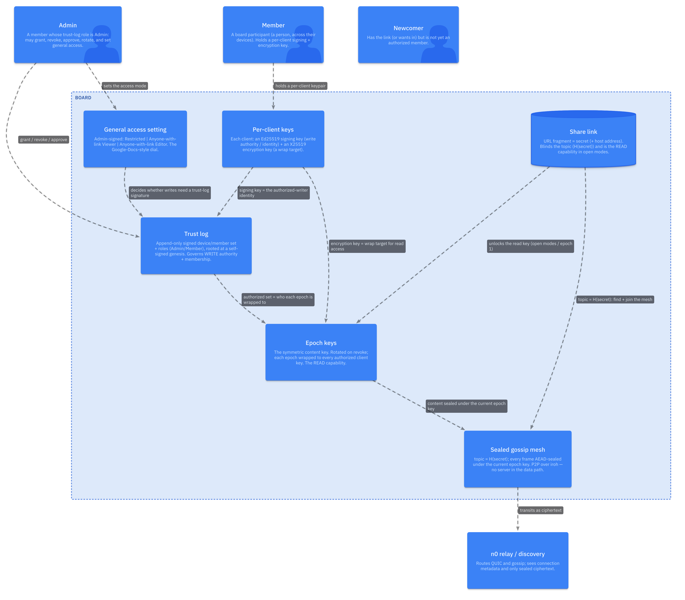

# Security model — architecture

The single reference for riftpipe's security **architecture**: the keys, the
capabilities, and how access is granted, restricted, and revoked. Companion docs:

- [`user-flows.md`](user-flows.md) — the same model as step-by-step user flows.
- [`../../SECURITY.md`](../../SECURITY.md) — what's *shipped today* (honest state).
- [`../planned/auth.md`](../planned/auth.md) — the device-linking auth deep-dive.

Diagrams are generated from [`likec4/security-model.likec4`](../../likec4/security-model.likec4)
via `npm run diagrams` — edit the model, not the images.

> **Status.** *Shipped:* the sealed mesh (secret-derived topic + AEAD frames,
> `PROTOCOL_VERSION` 2), `core::identity` (device keys + signed trust log),
> per-client encryption keys (`core::keywrap`), epoch-key wrapping
> (`core::epoch::EpochBook`), request-to-join, and read-revocation by epoch
> rotation (`PROTOCOL_VERSION` 4). *Planned:* the Anyone-with-link **Viewer**
> access mode. This doc describes the whole model; each section flags what is
> built vs planned.

## Two capabilities, kept separate

Everything reduces to two independent capabilities. Keeping them separate is what
makes "anyone can view, only some can edit" and "remove one person" both express.

- **READ** — the ability to *decrypt* board content. It's holding the current
  **epoch key** (below). You get it either from the **share link** (open modes)
  or by being **wrapped in** (restricted mode).
- **WRITE** — the ability to make changes *other peers accept*. It's gated either
  by **epoch-key possession** (open-editor mode — sealing is the gate, today's
  model) or by a **trust-log signature** (member mode — per-client signing keys).

## The pieces

### Share link — the read capability + the door (shipped)

The link's URL fragment carries a 32-byte **secret** (+ the host address). It
does two jobs: it **blinds the topic** (`topic = H(secret)`, so a stranger who
only learns the host's public key can't find the board), and in the open access
modes it *is* the read capability (it derives the content key). The fragment
never reaches a server. See `SECURITY.md` for the shipped detail.

### Per-client keys — identity + wrap target (shipped)

Each client (a device) holds its own keypair — never copied between devices:

- an **Ed25519 signing key** — its identity and **write authority** (shipped as
  `core::identity`);
- an **X25519 encryption key** — a **wrap target**, so the content key can be
  encrypted *to* it (shipped as `core::keywrap`; the basis of read-revocation).

An *identity* is the **set** of a person's device keys. Because each device signs
with its own key, a lost device is revoked on its own without touching the rest.

### Trust log — write authority + membership (shipped)

An append-only log of **signed** entries — a self-signed **genesis** (the founder
= permanent Admin), **grants**, and **revokes** — replicated like any file and
verified on apply. It answers "is this key an authorized writer, and in what
**role**?" Two roles: **Admin** (may grant, revoke, approve, rotate, set access)
and **Member** (read/write only). Out-of-order entries are buffered and resolve to
a fixpoint (`core::identity::TrustLog`). This governs **WRITE** and membership.

### Epoch keys — the read capability, rotatable (shipped)

The symmetric **content key** that seals board frames a second time on a
**Restricted** board, inside the outer board-secret seal (`MeshMsg::Sealed`).
Unlike a single link-derived secret, it **rotates**: any online Admin whose
latest epoch still wraps a now-revoked device mints a new epoch key and
**wraps it to each still-authorized client's encryption key**
(`MeshMsg::Epoch`, Admin-signed; one small blob each). The removed client
isn't wrapped in, so it can't derive the new key — everything from that epoch
on is opaque to it. Any online Admin also **auto add-wraps** an authorized
device it has a key for but that isn't in the latest epoch yet, without a
rotation — this is what makes a grant/approval deliver read access, not just
write access. Naive O(members) wrapping is the right choice at riftpipe's
scale (TreeKEM/BeeKEM is overkill until boards are large). This is what makes
**read-revocation** real.

### Sealed gossip mesh — the data plane (shipped)

`topic = H(secret)`, every frame AEAD-sealed under the board secret; on a
**Restricted** board, content is sealed a second time under the current
epoch key. Synced P2P over iroh — no server in the data path; the n0 relay
only ever sees connection
metadata and ciphertext.

## General access — the Google-Docs-style dial (Restricted + Editor shipped; Viewer deferred)

An **Admin-signed** board setting (just another signed trust-log-style entry)
would pick how open the board is. It's the familiar Google Docs "General
access" control, expressed through the read/write split:

| Mode | Read (epoch key) | Write | Status |
|---|---|---|---|
| **Restricted** | only clients wrapped in (request-to-join) | trust-log members only | shipped (`--restricted` / claimed) |
| **Anyone-with-link — Viewer** | anyone with the link | trust-log members only | deferred |
| **Anyone-with-link — Editor** | anyone with the link | anyone with the link | shipped — today's open-board default |

`core::epoch::AccessMode` is the one switch every driver already consults
(`LinkEditor` / `LinkViewer` / `Restricted`), so turning on Viewer needs only
an Admin-signed access setting to pick it (an appended `TrustEntry` or
`MeshMsg` variant) — no content-wire change.

So "set permission for anyone with a link" would be a first-class mode: the
link grants **read** to all holders, and the access setting decides whether
**write** also rides the link (Editor) or is restricted to granted members
(Viewer). Restricted mode drops the link as a read grant entirely and
requires an explicit wrap.

## Granting & revoking access

- **Add your own device** — co-present, high assurance: the new device shows its
  pubkey out-of-band (QR / short code), an Admin confirms and signs a grant +
  wraps the current epoch key. (`user-flows.md` → *Link a device*.)
- **Add another person** — asynchronous, à la Google Docs: they open the link and
  broadcast a signed **join request**; an Admin approves (grant + wrap) whenever
  next online. Identity assurance is a spectrum — self-asserted name → out-of-band
  confirm → optional provider-verified token. (`user-flows.md` → *Request access*.)
- **Revoke write** — *easy, shipped mechanism*: an Admin signs a `Revoke`; every
  peer that has it rejects that key's future writes locally (no coordinator).
  Eventually-consistent — a partitioned peer keeps accepting until the revoke
  reaches it, and already-accepted writes stay in history.
- **Revoke read** — *shipped*: any online Admin whose latest epoch still wraps
  a now-revoked device rotates to a new epoch key wrapped to the remaining
  clients only. Past content the removed party already decrypted is
  unrecoverable (true everywhere).
- **Persistence** — raw epoch keys are **never** written anywhere; only
  verified announces are persisted (wraps are ciphertext to their recipients)
  and re-opened with the device seed. The browser keeps them, and the trust
  log, per board: `localStorage["riftpipe:epochs:<topic>"]` and
  `["riftpipe:trust:v2:<topic>"]`, so opening another board never overwrites
  (and so never unlocks) a claimed one; native peers keep nothing
  on disk and relearn every epoch from the swarm each session, the same as
  the native trust log.

## What the relay / an outsider sees

- **Outsider (no link):** cannot derive the topic (`H(secret)`) — can't find or
  join the board. If they somehow reach the swarm, frames are AEAD ciphertext.
- **n0 relay:** connection metadata (which endpoints talk, when) and sealed
  ciphertext only — never content or the topic seed.
- **Revoked member:** stays a gossip member — still opens `Presence`/
  `Version`/the trust log (including its own `Revoke`)/`Request`s/`Epoch`
  announces, so it learns device ids and wrap counts but not the keys. Its
  own writes are rejected everywhere immediately (once the revoke
  propagates); it can't open content sealed under the new epoch, but during
  the propagation window still reads content sealed by a remaining member
  who hasn't seen the revoke yet (inherent to eventual consistency). A member
  that has seen the revoke but not the new epoch holds its writes instead of
  sealing under an epoch that still wraps the revoked device, and sends them
  once the new epoch arrives. It keeps only what it already saw.

## Deliberately deferred

- **Concurrent-admin conflict resolution** (A revokes B while B revokes A) — v1
  merges by set-union, not a canonical order.
- **TreeKEM-style O(log n) rotation** — unneeded at our scale.
- **Provider-verified identity** (Google/passkey token in a join request) — an
  optional add-on, never required; see `auth.md`.
