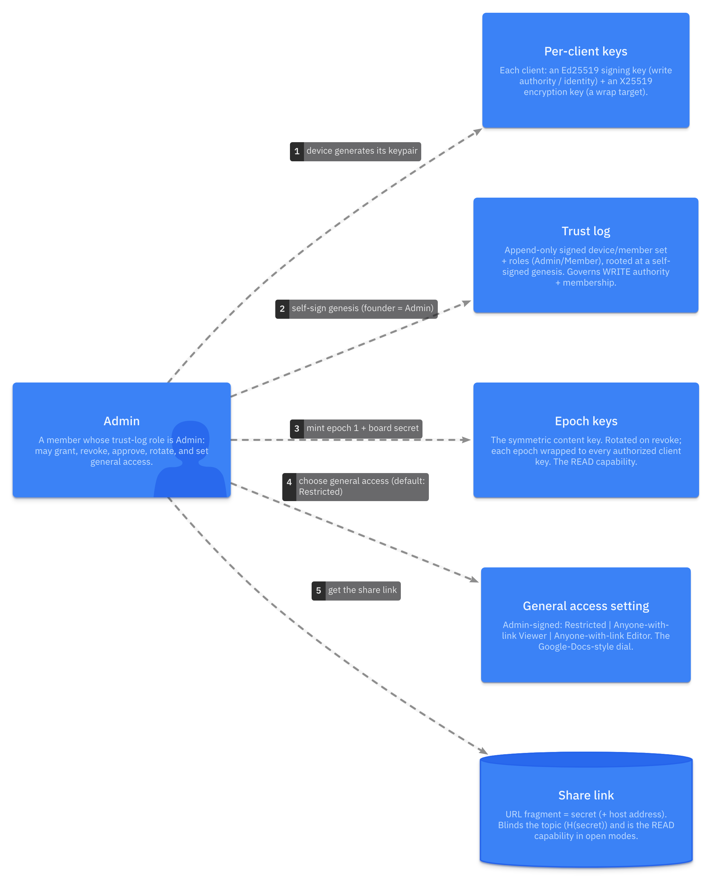
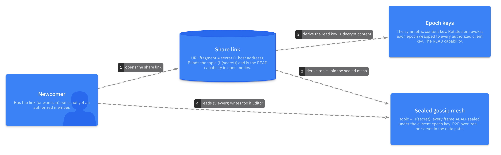
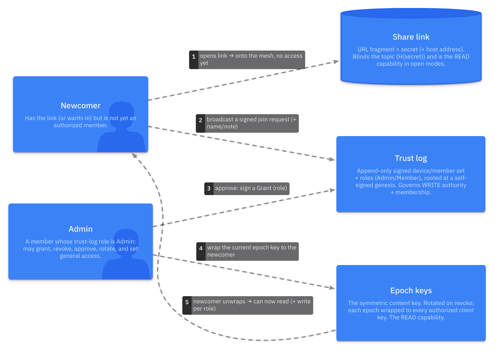
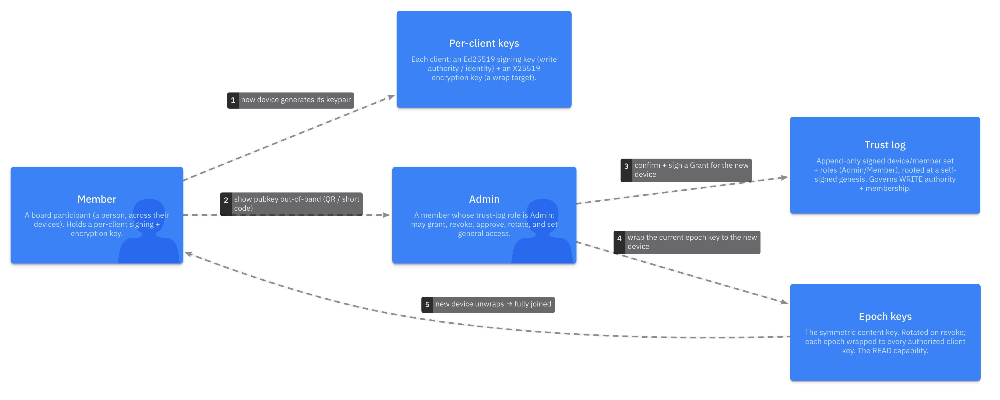
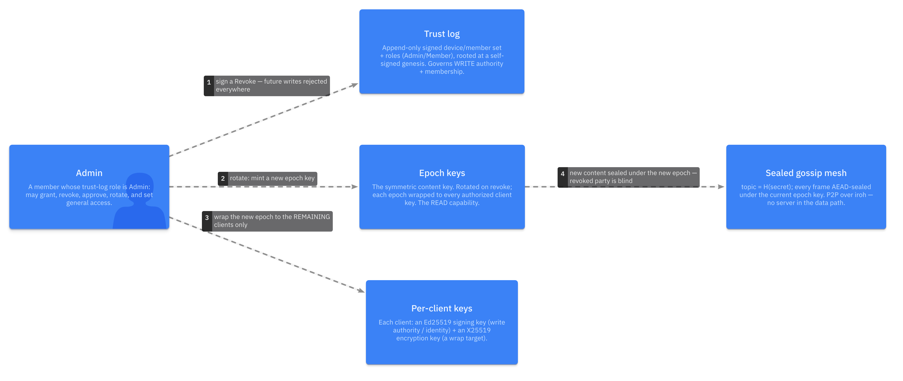

# Security model — user flows

The riftpipe security model as the concrete things a **user** does. Each flow is a
sequence diagram generated from
[`likec4/security-model.likec4`](../../likec4/security-model.likec4) (`npm run
diagrams`). For the components these flows move between, see
[`architecture.md`](architecture.md).

Recurring vocabulary: **grant** (a signed trust-log entry authorizing a key),
**wrap** (encrypting the current epoch/content key to a client's key so it can
read), **epoch** (a content key that rotates on revoke). *Shipped vs planned* is
flagged per flow.

## Create a board

*(Shipped: genesis + secret + first epoch key. Planned: a switchable
general-access setting — today's mode is fixed at creation, Restricted or
open Editor.)*

The founder's first device bootstraps everything: it generates its keypair,
self-signs the **genesis** (making itself the founding Admin), mints the board
secret + first epoch key, picks a general-access mode (default **Restricted**),
and gets a share link.

## Anyone-with-link opens the board

*(Shipped for Editor mode — this is today's behaviour. Viewer mode planned.)*

In the open access modes, the link is the read capability: opening it derives the
topic (joining the sealed mesh) and the read key (decrypting content). In
**Viewer** mode the newcomer can read; in **Editor** mode they can read and write
— sealing under the epoch key is the gate.

This is the "set permission for anyone with a link" path: an Admin has set the
board to Anyone-with-link (Viewer or Editor), so no approval step is needed.

## Request to join (Restricted mode)

*(Shipped: browser Ask/Approve — `e2e/lock-grant.mjs`; CLI `connect --restricted
--name <text>` → `riftpipe requests <dir>` → `riftpipe approve <dir>
<safety-code>`, interoperable with the browser both ways —
`e2e/request-approve.mjs`. `--grant <id>` at startup and `riftpipe grant <dir>
<id>` still authorize a device by id.)*

When the board is **Restricted**, the link gets a newcomer onto the mesh but
grants no access. They broadcast a **signed join request** (with a name/note so
the admin knows who they are); the request waits on the board until an **Admin**
comes online — the flow is fully asynchronous, no simultaneity required. The Admin
approves with one action: sign a **grant** (with a role) and **wrap** the current
epoch key to the newcomer, who then unwraps it and is in.

Identity assurance is a spectrum, same mechanism throughout: approve a recognized
self-asserted name → confirm out-of-band ("what's your code?") → require a
provider-verified token (optional, for boards that want it).

## Link your own device

*(Planned. Synchronous, high-assurance — for your own devices.)*

Adding a device you control is co-present so the binding is strong: the new device
generates its keypair and shows its pubkey out-of-band (QR / short code), the
existing device (an Admin) confirms it's really yours and signs a **grant** +
**wraps** the epoch key. This is the Signal/WhatsApp "scan to link" pattern.

The out-of-band QR/code is the security crux — it binds the new key to a physical
action by someone who already holds an authorized device, so no one on the mesh
can add themselves.

## Revoke a member

*(Shipped: CLI `riftpipe revoke <dir> <id>`; browser "Remove" on a member —
read-revoke rotates the epoch key, the write-revoke mechanism is unchanged.)*

Removing access is two steps for two capabilities. The **write** side is easy: an
Admin signs a **Revoke**, and every peer that receives it rejects that key's
future writes locally (no coordinator — that's why distributed is fine). The
**read** side rotates the epoch: mint a new content key and wrap it to the
*remaining* clients only, so the revoked party is blind to everything from the new
epoch on.

Caveats (inherent to an offline-first distributed system): write-revoke is
eventually-consistent — a partitioned peer keeps accepting the revoked key until
the revoke reaches it, and writes already accepted stay in history; and past
content the revoked party already decrypted can't be clawed back.

## How the flows relate

| Goal | Flow | Assurance | Sync? |
|---|---|---|---|
| Start a board | Create | — | — |
| Let everyone in | Open link (Viewer/Editor) | link possession | async |
| Add a specific person | Request access | self-asserted → verified | async |
| Add your own device | Link a device | co-present (QR) | sync |
| Remove someone | Revoke (+ rotate) | admin-signed | async |

Everything funnels to the same primitives — a **signed trust-log entry** for
write authority and a **wrap** for read access — so these flows share one
mechanism and differ only in how access is triggered and how strongly identity is
checked.
